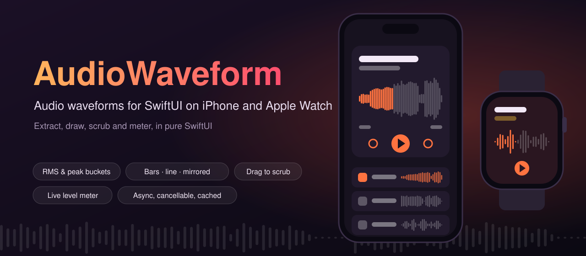
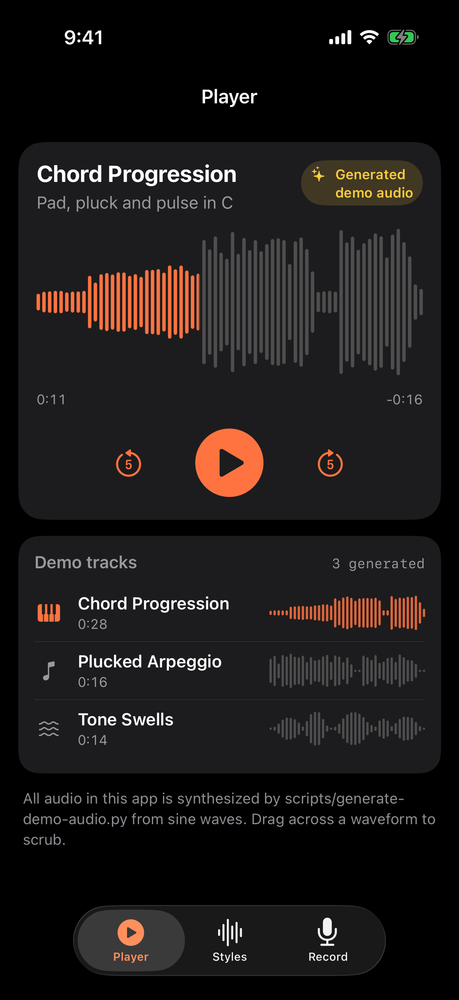
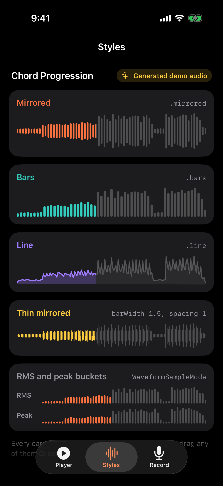
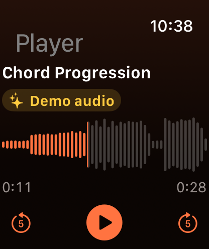

<p align="center">
  
</p>

<p align="center">
  <a href="https://github.com/halilozel1903/AudioWaveform/actions/workflows/ci.yml"></a>
  
  
  
  
  
  <a href="LICENSE"></a>
</p>

**AudioWaveform** draws audio waveforms in SwiftUI on iPhone and Apple Watch. It reads audio files with `AVAudioFile` and reduces them to **RMS or peak buckets** off the main thread (async, cancellable, cached), draws them as **bars**, a **line** or **mirrored** bars with **played and unplayed colours**, lets people **scrub with a drag** (or the Digital Crown), shows a **live recording level meter** fed by an `AVAudioEngine` tap, and comes with a small **player** whose progress a waveform binds to. The microphone sits behind an input protocol, so the same meter runs on an audio file in the simulator, in previews and in tests. The math (bucketing, normalisation, resampling, decibels, layout) is pure and unit tested. No dependencies.

```swift
import AudioWaveform
import AudioWaveformUI

@State private var player = WaveformPlayer()
@State private var waveform = Waveform.empty

WaveformView(waveform: waveform, progress: $player.progress, style: .mirrored, played: .orange)
    .frame(height: 80)
    .task {
        waveform = (try? await WaveformExtractor.shared.waveform(for: url, bucketCount: 256)) ?? .empty
        try? player.load(url)
    }
```

## Screenshots

Captured by CI from the example app, *Waves*, on an iPhone and an Apple Watch simulator. The tracks are **generated demo audio**: three short clips synthesized from sine waves by `scripts/generate-demo-audio.py` and bundled with the app, labeled as demo audio on screen. No recordings or music from anywhere else are used.

| iPhone: player | iPhone: styles | Watch: player |
| :---: | :---: | :---: |
|  |  |  |

> **All audio in the example app is generated demo audio.** The three tracks (*Chord Progression*, *Plucked Arpeggio*, *Tone Swells*) are synthesized from sine waves by [`scripts/generate-demo-audio.py`](scripts/generate-demo-audio.py) and committed as `.caf` files in `Example/Shared/DemoAudio`. They are not recordings of anything. The app labels them **Generated demo audio** on screen. In the screenshots the player is paused at 42 % so the frames are stable.
>
> **The recorder is not in the screenshots.** The simulator has no real microphone input, and the screenshots never fake one. In the app, the *Record* tab can run on the microphone or on the selected demo track through `FileLevelSource`, the same `AudioLevelSource` interface the microphone uses; it says which one on screen.

## Features

- **Sample extraction**: `WaveformExtractor` reads any file `AVAudioFile` can open (CAF, WAV, AIFF, M4A, MP3, …) in chunks, mixes channels to mono and reduces the signal to a fixed number of RMS or peak buckets without holding the samples in memory. It runs on a background task, stops as soon as the calling task is cancelled (a `.task` that goes away, a cell that is reused), and caches results per file and options with a least-recently-used limit.
- **Three styles**: `.bars` (rising from the bottom), `.mirrored` (around the centre line, like a voice message) and `.line` (a stroked line with an optional fill). Bar width, spacing, corner radius, minimum height and line width are all adjustable. Waveforms are drawn with `Canvas`, so thousands of bars stay cheap.
- **Played and unplayed colours**: the played part is drawn in one colour and the rest in another, split exactly at the progress, even in the middle of a bar.
- **Scrubbing**: give `WaveformView` a progress binding and a drag sets it; `onEditingChanged` tells you when a drag starts and ends (to pause while scrubbing). VoiceOver users adjust it by swiping up and down. On Apple Watch, add `.digitalCrownRotation` with the same binding.
- **Player helper**: `WaveformPlayer` wraps `AVAudioPlayer` with an observable `currentTime`, `duration`, `isPlaying` and a settable `progress`, so `$player.progress` is the scrubbing binding. Play, pause, toggle, seek, skip and loop.
- **Live level meter**: `LevelMonitor` turns any `AudioLevelSource` into a smoothed level, a peak hold, decibels, the elapsed time and a rolling history. `LiveWaveformView` draws the history scrolling to the left, and `LevelIndicator` is a green to red bar with a peak tick.
- **Simulator-friendly input**: `MicrophoneLevelSource` taps `AVAudioEngine`'s input node (and asks for permission, and sets up the audio session); `FileLevelSource` reads a file in real time through the same protocol. Write your own source for anything else.
- **Pure, tested math**: `WaveformMath` (bucket ranges, RMS and peak buckets, normalisation, resampling that keeps peaks, decibel conversion, meter ballistics), `BucketAccumulator` (streaming buckets), `WaveformLayout` (bar rectangles, line points, touch to progress) and `WaveformTime` (`1:05`, `-0:23`). Swift Testing suites cover them, plus end-to-end extraction from real files written with `AVAudioFile`, caching, cancellation and the level monitor, on macOS, iOS and watchOS.
- **Swift 6 strict concurrency**: values are `Sendable`, the extractor is an actor, the player and monitor are `@MainActor @Observable`, and audio callbacks never touch the main actor.

## API

| Type | What it does |
| --- | --- |
| `WaveformExtractor` | Actor. `waveform(for:options:)`, `waveform(for:bucketCount:mode:)`, `cachedWaveform(for:options:)`, `cachedCount`, `removeWaveforms(for:)`, `removeAll()`, `countLimit`, `shared` |
| `WaveformExtractor.Options` | `bucketCount` (512), `mode` (`.rms`), `normalizes` (true), `framesPerRead` (32,768) |
| `AudioFileReader` | `waveform(of:options:)`: the synchronous extraction, checks for cancellation between chunks |
| `Waveform` | `samples` (`0...1`), `duration`, `sampleRate`, `mode`, `resampled(to:)`, `time(atProgress:)`, `progress(atTime:)`, `empty` |
| `WaveformSampleMode` | `.rms` or `.peak` |
| `WaveformMath` | `bucketRange`, `buckets`, `rms`, `peak`, `normalize`, `clamped`, `resample`, `decibels(fromAmplitude:)`, `amplitude(fromDecibels:)`, `normalizedLevel(decibels:floor:)`, `smoothed`, `appending(_:to:capacity:)` |
| `BucketAccumulator` | Streaming buckets: `append(_:)`, `append(contentsOf:)`, `values(for:)`, `isComplete` |
| `WaveformLayout` | `barCount`, `barRects`, `trailingBarRects`, `linePoints`, `progress(forX:width:)` |
| `WaveformPlayer` | `@MainActor @Observable`. `load(_:)`, `play()`, `pause()`, `togglePlayback()`, `stop()`, `seek(to:)`, `seek(toProgress:)`, `skip(by:)`, `progress` (settable), `currentTime`, `duration`, `isPlaying`, `isLooping` |
| `AudioLevelSource` | Protocol: `levels() -> AsyncThrowingStream<AudioLevel, any Error>` |
| `MicrophoneLevelSource` | `AVAudioEngine` input tap; asks for permission; `bufferSize` |
| `FileLevelSource` | A file read in real time: `url`, `interval`, `loops`, `paced` |
| `AudioLevel` | `rms`, `peak`, `duration`, `rmsDecibels`, `peakDecibels`, `normalized(floor:)`, `init(measuring: AVAudioPCMBuffer)` |
| `LevelMonitor` | `@MainActor @Observable`. `start(_:)`, `stop()`, `reset()`, `receive(_:)`, `history`, `level`, `peakHold`, `decibels`, `elapsed`, `isRunning`, `errorMessage`, `capacity`, `floorDecibels` |
| `WaveformTime` | `format(_:)`, `remaining(_:of:)` |
| `WaveformError` | `unreadableFile`, `emptyFile`, `bufferAllocationFailed`, `microphonePermissionDenied`, `noInputDevice`, `engineFailed` |
| **AudioWaveformUI** | |
| `WaveformView` | `init(waveform:progress:style:played:unplayed:onEditingChanged:)` with a `Binding<Double>` to scrub, or a `Double` to only show progress; also `init(samples:…)` |
| `AsyncWaveformView` | Loads a file's waveform with an extractor in `.task`; placeholder while loading; optional progress binding and `onLoad` |
| `WaveformStyle` | `.bars`, `.mirrored`, `.line`; `kind`, `barWidth`, `spacing`, `cornerRadius`, `minimumBarHeight`, `lineWidth`, `fillsLine` |
| `LiveWaveformView` | Scrolling bars of live levels, newest on the right |
| `LevelIndicator` | A horizontal level bar with a peak tick |

## Installation

In Xcode choose **File › Add Package Dependencies…** and enter:

```
https://github.com/halilozel1903/AudioWaveform
```

Or add it to `Package.swift`:

```swift
dependencies: [
    .package(url: "https://github.com/halilozel1903/AudioWaveform", from: "1.0.0")
],
targets: [
    .target(name: "MyApp", dependencies: [
        .product(name: "AudioWaveform", package: "AudioWaveform"),
        .product(name: "AudioWaveformUI", package: "AudioWaveform"),   // the SwiftUI views
    ])
]
```

For the microphone meter, add `NSMicrophoneUsageDescription` to your app's Info.plist. Waveforms and playback need no permissions.

## Usage

### Extract a waveform

```swift
let extractor = WaveformExtractor.shared

// 256 RMS buckets, normalised so the loudest is 1.
let waveform = try await extractor.waveform(for: url, bucketCount: 256)
waveform.samples.count       // 256
waveform.duration            // 28.0 seconds

// Peak buckets, absolute levels (full scale is 1), read in smaller chunks.
let options = WaveformExtractor.Options(bucketCount: 1024, mode: .peak, normalizes: false, framesPerRead: 8192)
let peaks = try await extractor.waveform(for: url, options: options)

// The second call for the same file and options comes from the cache.
await extractor.cachedWaveform(for: url, options: options)    // Waveform?
await extractor.removeWaveforms(for: url)                     // after the file changed
```

Extraction stops with `CancellationError` when its task is cancelled, so starting it from `.task(id:)` cancels it automatically when the view goes away or the URL changes. `AsyncWaveformView` does exactly that:

```swift
List(memos) { memo in
    AsyncWaveformView(url: memo.url, options: .init(bucketCount: 128), style: .bars)
        .frame(height: 28)
}
```

### Draw it

```swift
WaveformView(waveform: waveform, progress: 0.3)                      // read only
WaveformView(waveform: waveform, progress: $progress, style: .bars)  // drag to scrub

var thin = WaveformStyle.mirrored
thin.barWidth = 1.5
thin.spacing = 1
WaveformView(waveform: waveform, progress: $progress, style: thin, played: .pink, unplayed: .gray.opacity(0.3))

WaveformView(waveform: waveform, progress: $progress, style: WaveformStyle(kind: .line, lineWidth: 2, fillsLine: true))
```

### Play and scrub

```swift
struct MemoPlayer: View {
    let url: URL
    @State private var player = WaveformPlayer()
    @State private var waveform = Waveform.empty
    @State private var resume = false

    var body: some View {
        VStack {
            WaveformView(waveform: waveform, progress: $player.progress, played: .orange) { isScrubbing in
                if isScrubbing { resume = player.isPlaying; player.pause() }
                else if resume { player.play() }
            }
            .frame(height: 64)

            HStack {
                Text(WaveformTime.format(player.currentTime))
                Spacer()
                Text(WaveformTime.remaining(player.currentTime, of: player.duration))
            }
            .font(.caption.monospacedDigit())

            Button(player.isPlaying ? "Pause" : "Play") { player.togglePlayback() }
        }
        .task {
            waveform = (try? await WaveformExtractor.shared.waveform(for: url, bucketCount: 300)) ?? .empty
            try? player.load(url)
        }
    }
}
```

On Apple Watch, the Digital Crown can scrub with the same binding:

```swift
WaveformView(waveform: waveform, progress: $player.progress)
    .focusable()
    .digitalCrownRotation($player.progress, from: 0, through: 1, by: 0.01, sensitivity: .low)
```

### Live level meter

```swift
@State private var monitor = LevelMonitor(capacity: 120, floorDecibels: -50)

VStack {
    LiveWaveformView(levels: monitor.history, color: .red)
        .frame(height: 80)
    LevelIndicator(level: monitor.level, peak: monitor.peakHold)
        .frame(height: 6)
    Text("\(Int(monitor.decibels)) dB")
    Button(monitor.isRunning ? "Stop" : "Start") {
        if monitor.isRunning {
            monitor.stop()
        } else {
            #if targetEnvironment(simulator)
            monitor.start(FileLevelSource(url: sampleURL))     // no useful microphone in the simulator
            #else
            monitor.start(MicrophoneLevelSource())           // asks for permission on first use
            #endif
        }
    }
    if let error = monitor.errorMessage { Text(error) }
}
```

`MicrophoneLevelSource` sets the audio session to play and record, installs a tap on the input node and stops the engine when the stream ends. Levels are measured on the audio thread and handed to the main actor as plain values. To feed levels from your own engine or recorder, call `monitor.receive(AudioLevel(measuring: buffer))`, or conform a type to `AudioLevelSource`:

```swift
struct RecorderLevels: AudioLevelSource {
    func levels() -> AsyncThrowingStream<AudioLevel, any Error> {
        AsyncThrowingStream { continuation in
            // Yield an AudioLevel per buffer; stop your input in onTermination.
        }
    }
}
```

### The math on its own

```swift
WaveformMath.buckets(samples, count: 100, mode: .peak)       // [Float], absolute values
WaveformMath.normalize([0.25, 0.5])                           // [0.5, 1.0]
WaveformMath.resample(values, to: 40)                         // keeps the largest value per group
WaveformMath.decibels(fromAmplitude: 0.5)                     // -6.02
WaveformMath.normalizedLevel(decibels: -25, floor: -50)       // 0.5
WaveformLayout.barRects(values: values, size: size, barWidth: 3, spacing: 2, alignment: .center)
```

## Example apps

The `Example` folder contains *Waves*, built with AudioWaveform and AudioWaveformUI:

- **iPhone**: *Player* with a large mirrored waveform, time, controls and the demo tracks (their small waveforms load through `AsyncWaveformView` from the extractor's cache); *Styles* with the same track in every style and RMS against peak buckets, all bound to one player; *Record* with the live meter on the microphone or a demo file.
- **Apple Watch**: vertical pages for the player (drag or turn the Digital Crown to scrub) and the level meter.

The demo audio is generated, not recorded. To regenerate it (Python 3, standard library only; the output is the same every time):

```bash
python3 scripts/generate-demo-audio.py
```

The project uses [XcodeGen](https://github.com/yonaskolb/XcodeGen), so no project file has to live in the repo:

```bash
brew install xcodegen
cd Example && xcodegen generate
open AudioWaveformDemo.xcodeproj
```

Run `WavesPhone` on an iPhone and `WavesWatch` on an Apple Watch. In the simulator the recorder starts on the demo file input; on a device it starts on the microphone. Launch with `-screenshot player|styles` (iPhone) or `-screenshot player` (Apple Watch) to open a scene paused at 42 %, as CI does for the screenshots above.

## Requirements

- Xcode 26 or later (Swift 6.2 toolchain)
- iOS 17+, watchOS 10+ (macOS 14+ only to run the tests)

## Contributing

Issues and pull requests are welcome. Please run the tests before opening a PR:

```bash
swift test
bash scripts/test.sh iOS
bash scripts/test.sh watchOS
```

## License

AudioWaveform is available under the MIT license. See [LICENSE](LICENSE). The demo audio in `Example/Shared/DemoAudio` is generated by the script in this repository and is covered by the same license. AudioWaveform is not affiliated with Apple. iPhone and Apple Watch are trademarks of Apple Inc.
